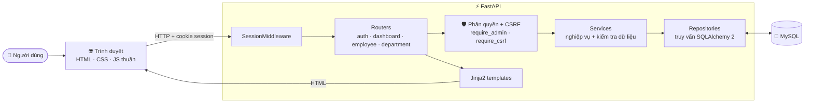
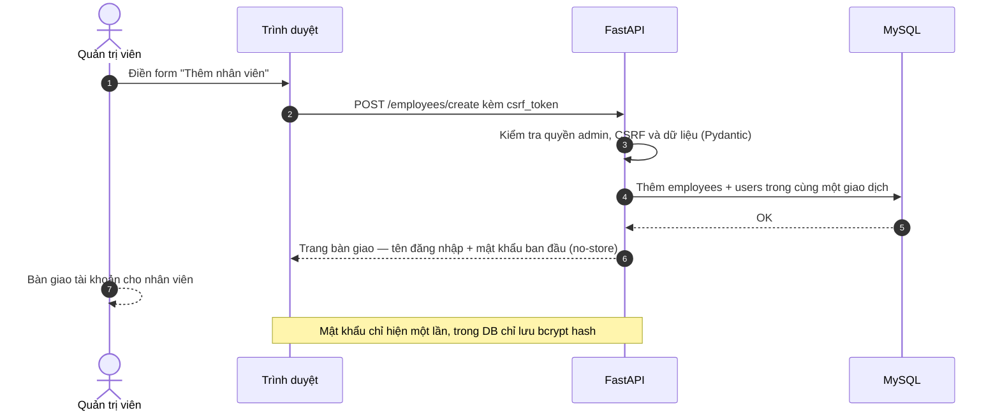
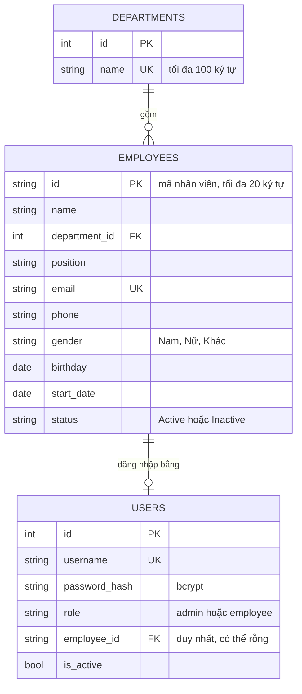

<div align="center">


# Hệ thống Quản lý Nhân sự

**Ứng dụng web quản lý hồ sơ nhân viên, phòng ban và tài khoản đăng nhập — FastAPI + MySQL, giao diện Jinja2 tự thiết kế, có chế độ sáng/tối và chạy tốt trên điện thoại.**

*A human-resource management web app built with FastAPI, SQLAlchemy 2, MySQL and server-rendered Jinja2.*


[Tính năng](#-tính-năng) · [Kiến trúc](#-kiến-trúc) · [Cài đặt](#-cài-đặt-và-chạy) · [Các trang](#-các-trang-chính) · [Kiểm thử](#-kiểm-thử)

</div>

---

## ✨ Tính năng

**Quản trị viên**
- 📊 **Tổng quan** — tổng số nhân viên, đang/ngừng hoạt động, số phòng ban, tỷ trọng nhân sự theo từng phòng ban.
- 👥 **Nhân viên** — danh sách; tìm theo mã hoặc họ tên (phím tắt `/`); lọc theo phòng ban, chức vụ, trạng thái; thêm, sửa, xem chi tiết; chuyển sang *ngừng hoạt động* mà vẫn giữ hồ sơ.
- 🔑 **Tự tạo tài khoản** khi thêm nhân viên — tên đăng nhập là mã nhân viên, mật khẩu sinh ngẫu nhiên và chỉ hiện **một lần** để bàn giao (có nút sao chép).
- 🏢 **Phòng ban** — thêm, đổi tên, không cho trùng tên.

**Nhân viên**
- 👤 Xem hồ sơ cá nhân và thông tin tài khoản.
- ✏️ Tự sửa họ tên, ngày sinh, giới tính, số điện thoại, email, địa chỉ. Phòng ban, chức vụ và ngày vào làm do quản trị viên quản lý.
- 🔒 Đổi mật khẩu (tối thiểu 8 ký tự; đổi xong phải đăng nhập lại).

**Trải nghiệm**
- 🌗 Giao diện sáng/tối theo hệ thống, nhớ lựa chọn của người dùng.
- 📱 Responsive: menu trượt trên điện thoại, bảng cuộn ngang.
- ⚡ Nút có trạng thái đang xử lý, toast thông báo, hộp thoại xác nhận, báo lỗi ngay dưới từng ô nhập.
- ♿ Dùng tốt bằng bàn phím và trình đọc màn hình (skip link, `aria-*`, viền focus rõ); tôn trọng `prefers-reduced-motion`.

<!--
  Ảnh chụp màn hình: kéo 4 ảnh vào ô bình luận của một issue trên GitHub để lấy link
  dạng https://github.com/user-attachments/assets/..., thay vào các chỗ LINK_ANH_* bên dưới,
  rồi xoá dòng mở comment phía trên và dòng đóng comment phía dưới khối này.

## 📸 Giao diện

<p align="center">
  
</p>

<details>
<summary><b>🌗 Giao diện sáng và tối</b></summary>
<br>

</details>

<details>
<summary><b>🔑 Bàn giao tài khoản và nhân viên tự sửa hồ sơ</b></summary>
<br>

</details>

<details>
<summary><b>📱 Trên điện thoại</b></summary>
<br>
<p align="center"></p>
</details>
-->

## 🧱 Kiến trúc



Mỗi module trong `app/modules/` chia theo lớp: **router** (nhận request, chọn template) → **service** (nghiệp vụ, kiểm tra trùng lặp) → **repository** (truy vấn CSDL). Dữ liệu form được kiểm tra bằng **Pydantic** trước khi vào service.

<details>
<summary><b>🔄 Luồng thêm nhân viên và tự tạo tài khoản</b></summary>



</details>

<details>
<summary><b>🗄️ Cơ sở dữ liệu</b></summary>



</details>

## 🧰 Công nghệ

| Thành phần | Công nghệ |
|---|---|
| Backend | FastAPI, Starlette `SessionMiddleware` |
| ORM / CSDL | SQLAlchemy 2 (`Mapped`), PyMySQL, MySQL 8 |
| Kiểm tra dữ liệu, cấu hình | Pydantic v2, pydantic-settings (`.env`) |
| Giao diện | Jinja2 render phía server · HTML, CSS, JavaScript thuần, không dùng framework |
| Bảo mật | bcrypt, CSRF token theo phiên, cookie `HttpOnly` + `SameSite=Lax` |
| Kiểm thử | FastAPI `TestClient` + SQLite trong RAM |

## 📁 Cấu trúc thư mục

```text
hr-management-web/
├── main.py                 # Khởi tạo FastAPI, middleware, xử lý lỗi, mount /static
├── seed.py                 # Tạo bảng + phòng ban, nhân viên, tài khoản mẫu
├── requirements.txt
├── .env.example            # Mẫu cấu hình
├── app/
│   ├── config.py           # Đọc cấu hình từ .env
│   ├── database.py         # Engine + SessionLocal
│   ├── models/             # Điểm import chung cho các model
│   ├── modules/
│   │   ├── auth/           # Đăng nhập, phân quyền, hồ sơ cá nhân, đổi mật khẩu
│   │   ├── dashboard/      # Thống kê tổng quan
│   │   ├── department/     # Quản lý phòng ban
│   │   └── employee/       # Quản lý nhân viên + kiểm tra CSRF
│   ├── templates/          # Giao diện Jinja2 (layout, component, từng trang)
│   └── static/             # CSS, JS (theme, toast, xác nhận, kiểm tra form)
└── tests/                  # Test tích hợp dùng SQLite trong RAM
```

## 🚀 Cài đặt và chạy

**Yêu cầu:** Python 3.10+ và MySQL 8.

**1. Lấy mã nguồn và cài thư viện**

```bash
git clone https://github.com/vinhnro0005-sys/hr-management-web.git
cd hr-management-web
python -m venv .venv
# Windows:      .venv\Scripts\activate
# macOS/Linux:  source .venv/bin/activate
pip install -r requirements.txt
```

**2. Tạo database (UTF-8 đầy đủ cho tiếng Việt)**

```sql
CREATE DATABASE hr_management CHARACTER SET utf8mb4 COLLATE utf8mb4_unicode_ci;
```

**3. Tạo file `.env`**

```bash
cp .env.example .env          # Windows: copy .env.example .env
python -c "import secrets; print(secrets.token_urlsafe(48))"
```

Dán chuỗi vừa in ra vào `SESSION_SECRET_KEY`, rồi điền tài khoản MySQL:

| Biến | Ý nghĩa | Mặc định |
|---|---|---|
| `DB_HOST` / `DB_PORT` | Địa chỉ MySQL | `127.0.0.1` / `3306` |
| `DB_USER` / `DB_PASSWORD` | Tài khoản MySQL | `root` / *(trống)* |
| `DB_NAME` | Tên database | `hr_management` |
| `SESSION_SECRET_KEY` | Khóa ký cookie phiên — **bắt buộc, phải ngẫu nhiên** | — |

**4. Tạo bảng và dữ liệu mẫu**

```bash
python seed.py
```

**5. Chạy ứng dụng**

```bash
uvicorn main:app --reload      # hoặc: python main.py
```

Mở <http://127.0.0.1:8000>.

> [!NOTE]
> Hãy chạy các lệnh từ **thư mục gốc** của dự án, vì đường dẫn tới template, static và `.env` đang là đường dẫn tương đối.

**Tài khoản mẫu do `seed.py` tạo**

| Vai trò | Tên đăng nhập | Mật khẩu |
|---|---|---|
| Quản trị viên | `admin` | `admin123` |
| Nhân viên (NV001) | `employee` | `employee123` |

> [!WARNING]
> Tài khoản mẫu chỉ dùng để chạy thử trên máy cá nhân. Khi triển khai thật: đặt `SESSION_SECRET_KEY` ngẫu nhiên, thay hoặc xóa tài khoản mẫu, và chạy sau HTTPS.

## 🧭 Các trang chính

| Phương thức | Đường dẫn | Quyền | Chức năng |
|---|---|---|---|
| GET · POST | `/login` | Công khai | Đăng nhập |
| POST | `/logout` | Đã đăng nhập | Đăng xuất |
| GET | `/dashboard` | Admin | Tổng quan nhân sự |
| GET | `/employees` | Admin | Danh sách, tìm kiếm, lọc |
| GET · POST | `/employees/create` | Admin | Thêm nhân viên và tạo tài khoản |
| GET | `/employees/{id}` | Admin | Xem hồ sơ |
| GET · POST | `/employees/{id}/edit` | Admin | Sửa hồ sơ |
| POST | `/employees/{id}/deactivate` | Admin | Ngừng hoạt động |
| GET | `/departments` | Admin | Danh sách và form thêm phòng ban |
| POST | `/departments/create` | Admin | Thêm phòng ban |
| GET · POST | `/departments/{id}/edit` | Admin | Đổi tên phòng ban |
| GET | `/profile` | Đã đăng nhập | Hồ sơ cá nhân |
| GET · POST | `/profile/edit` | Nhân viên | Tự sửa thông tin cá nhân |
| GET · POST | `/profile/change-password` | Nhân viên | Đổi mật khẩu |

## 🔐 Bảo mật đã có

- Mật khẩu băm bằng **bcrypt**; mật khẩu ban đầu sinh ngẫu nhiên, chỉ hiện một lần, trang bàn giao gửi `Cache-Control: no-store`.
- Mọi form POST, kể cả đăng xuất, đều kiểm tra **CSRF token** gắn với phiên.
- Tạo phiên mới khi đăng nhập (chống session fixation); cookie `HttpOnly`, `SameSite=Lax`.
- Phân quyền theo vai trò ngay ở tầng router; nhân viên bị ngừng hoạt động sẽ bị đăng xuất ở request kế tiếp.
- Jinja2 tự escape dữ liệu hiển thị; mọi truy vấn đi qua ORM.

## 🧪 Kiểm thử

Test dùng SQLite trong RAM nên **không cần MySQL**. Cần cài thêm `httpx`:

```bash
pip install httpx
```

```bash
# macOS / Linux
export SESSION_SECRET_KEY=dev-test-secret-key-at-least-32-characters
PYTHONPATH=tests python tests/test_employee_auth_refactor.py
PYTHONPATH=tests python tests/test_profile_edit.py
```

```powershell
# Windows PowerShell
$env:SESSION_SECRET_KEY = "dev-test-secret-key-at-least-32-characters"
$env:PYTHONPATH = "tests"
python tests/test_employee_auth_refactor.py
python tests/test_profile_edit.py
```

Mỗi script chạy luôn cả bài test đăng nhập và phân quyền trong `tests/test_auth_integration.py`.

## 📌 Lộ trình

- [x] Đăng nhập, phân quyền quản trị viên / nhân viên
- [x] Quản lý nhân viên, phòng ban; tìm kiếm và lọc
- [x] Trang tổng quan thống kê
- [x] Tự tạo tài khoản khi thêm nhân viên, đổi mật khẩu, tự sửa hồ sơ
- [x] Giao diện sáng/tối, responsive
- [ ] Đặt lại mật khẩu cho nhân viên, kích hoạt lại hồ sơ
- [ ] Phân trang danh sách, xuất Excel
- [ ] Chấm công, tính lương
- [ ] Migration bằng Alembic

Kế hoạch chi tiết: [`PLAN_FASTAPI_MYSQL.md`](PLAN_FASTAPI_MYSQL.md).
