# Báo cáo review codebase `hr-management-web`

> [!NOTE]
> **Chỉ review, không sửa code dự án.** Đã đọc toàn bộ 69 file (Python, Jinja2, JS, cấu hình, test). Các lỗi ghi **✅ Đã tái hiện** đã được chạy thật bằng script thử trên SQLite trong RAM (đặt trong thư mục `scratch/` của báo cáo, không nằm trong repo). Môi trường: Python 3.13, FastAPI 0.141.1, Starlette 1.6.0, **bcrypt 5.0.0**, Pydantic 2.13.

## Tổng quan

| Mức độ | Số lượng | Ý nghĩa |
|---|---|---|
| 🔴 Cao | 4 | Gây lỗi 500, hiện trang JSON thô, hoặc thiếu chức năng cốt lõi mà người chấm dễ gặp khi demo |
| 🟠 Trung bình | 8 | Lỗ hổng bảo mật thực tế, lỗi dữ liệu, hoặc UX rõ ràng là chưa hoàn thiện |
| 🟡 Thấp | 12 | Trường hợp biên, chỉ gặp khi cố tình gửi request lạ, hoặc UX nhỏ |
| ⚪ Ghi chú | 9 | Chất lượng code, thiếu chức năng phụ, hoặc khác biệt giữa môi trường |

Nhìn chung code có cấu trúc rõ (router → service → repository), đã có CSRF, bcrypt, Jinja tự escape, truy vấn qua ORM; **không tìm thấy SQL injection hay XSS**. Phần lớn vấn đề nằm ở **xử lý lỗi chưa đủ** và **thiếu một số chức năng quản trị**.

---

## 🔴 MỨC CAO

### H1. Mật khẩu dài hơn 72 byte làm sập trang đăng nhập và đổi mật khẩu (lỗi 500) — ✅ Đã tái hiện
- **Vị trí:** [security.py](file:///c:/Users/pdqvi/Documents/GitHub/hr-management-web/app/modules/auth/security.py#L6-L14), [requirements.txt](file:///c:/Users/pdqvi/Documents/GitHub/hr-management-web/requirements.txt#L10)
- **Nguyên nhân:** `requirements.txt` ghi `bcrypt>=4.0.0` nên máy hiện cài **bcrypt 5.0.0**. Từ bản 5.0, `hashpw`/`checkpw` **ném `ValueError`** khi mật khẩu dài hơn 72 byte. Code không bắt lỗi này.
- **Tái hiện:**
  - `POST /login` với mật khẩu dài 80 ký tự → **500 Internal Server Error** (trang chữ thuần).
  - `POST /profile/change-password` với mật khẩu mới dài 80 ký tự → **500**.
  - Tiếng Việt có dấu tốn 2–3 byte mỗi ký tự, nên chỉ cần khoảng 25–35 ký tự có dấu là đã vượt 72 byte.
- **Ảnh hưởng khi demo:** Người chấm thường thử "mật khẩu rất dài" và sẽ thấy ngay trang lỗi server.
- **Hướng sửa:** Giới hạn độ dài mật khẩu tính theo byte (≤ 72) ở form và service, hoặc bắt `ValueError` trong `verify_password` rồi trả `False`. Nên ghim phiên bản thư viện (`bcrypt==4.x` hoặc xử lý đúng với 5.x).

### H2. Quản trị viên không thể đổi mật khẩu, nên `admin123` dùng mãi mãi — ✅ Đã tái hiện
- **Vị trí:** [auth_service.py](file:///c:/Users/pdqvi/Documents/GitHub/hr-management-web/app/modules/auth/auth_service.py#L139-L141), [auth_router.py](file:///c:/Users/pdqvi/Documents/GitHub/hr-management-web/app/modules/auth/auth_router.py#L306-L307) và [L328-L329](file:///c:/Users/pdqvi/Documents/GitHub/hr-management-web/app/modules/auth/auth_router.py#L328-L329)
- **Mô tả:** `GET/POST /profile/change-password` chuyển admin về `/profile`, service cũng chặn cứng ("Quản trị viên không có quyền thay đổi mật khẩu của chính bản thân"). Tài khoản có quyền cao nhất lại dùng mật khẩu mặc định yếu mà **không có cách nào đổi qua giao diện**. README thì khuyên "thay hoặc xóa tài khoản mẫu".
- **Ảnh hưởng:** Đây là lỗ hổng bảo mật về thiết kế và người chấm dễ hỏi tới.
- **Hướng sửa:** Cho admin đổi mật khẩu của chính mình (vẫn bắt nhập mật khẩu hiện tại).

### H3. Không có chức năng cấp lại hoặc đặt lại mật khẩu cho nhân viên
- **Vị trí:** [employee_service.py](file:///c:/Users/pdqvi/Documents/GitHub/hr-management-web/app/modules/employee/employee_service.py#L102-L137), [created.html](file:///c:/Users/pdqvi/Documents/GitHub/hr-management-web/app/templates/employees/created.html)
- **Mô tả:** Mật khẩu ban đầu chỉ hiện **một lần** trên trang trả về từ POST. Nếu admin lỡ đóng tab, bấm F5 (lúc đó sẽ báo "Mã nhân viên đã tồn tại"), hoặc nhân viên quên mật khẩu, thì **không có cách khôi phục**: không có nút "Đặt lại mật khẩu" và không có trang quản lý tài khoản. Nhân viên đó bị khóa ngoài vĩnh viễn trừ khi sửa thẳng trong DB.
- **Hướng sửa:** Thêm `POST /employees/{id}/reset-password` (chỉ admin) để sinh mật khẩu mới và hiện lại trang bàn giao.

### H4. Bộ lọc cũ hoặc không hợp lệ hiện **trang JSON thô** thay cho giao diện — ✅ Đã tái hiện
- **Vị trí:** [employee_service.py](file:///c:/Users/pdqvi/Documents/GitHub/hr-management-web/app/modules/employee/employee_service.py#L43-L57), [main.py](file:///c:/Users/pdqvi/Documents/GitHub/hr-management-web/main.py#L50-L68) (handler chỉ render HTML cho lỗi 403 và 404)
- **Kịch bản demo rất dễ gặp:**
  1. Lọc danh sách theo chức vụ "Tester" (chỉ có 1 người).
  2. Sửa người đó, đổi chức vụ thành "Dev", rồi lưu. Ứng dụng chuyển về `/employees/NV001?position=Tester` (giữ bộ lọc).
  3. Bấm "Danh sách" hoặc breadcrumb "Nhân viên" → trình duyệt hiện `{"detail":"Chức vụ không hợp lệ"}` (HTTP 400, JSON).
- Tương tự với `/employees?department_id=abc` hoặc `?status=xyz`.
- **Hướng sửa:** Coi giá trị lọc không hợp lệ là "không lọc" (bỏ qua), hoặc thêm trang HTML cho lỗi 400 trong exception handler.

---

## 🟠 MỨC TRUNG BÌNH

### M1. Mã nhân viên không kiểm tra định dạng, nên có hồ sơ không bao giờ mở được — ✅ Đã tái hiện
- **Vị trí:** [employee_schemas.py](file:///c:/Users/pdqvi/Documents/GitHub/hr-management-web/app/modules/employee/employee_schemas.py#L78-L79)
- `id` chỉ giới hạn 1–20 ký tự, chấp nhận mọi ký tự:
  - Mã **`create`**: tạo được, nhưng `/employees/create` luôn khớp route "Thêm nhân viên", nên **không xem được hồ sơ** (nút "Xem hồ sơ" ở trang bàn giao mở ra form trống).
  - Mã chứa **`/`** (ví dụ `NV/02`): tạo được, nhưng mọi link `/employees/NV/02` đều **404**, nên không xem, sửa hay ngừng hoạt động được.
  - Mã có khoảng trắng, `#`, `%`, `..` cũng làm hỏng link và breadcrumb ([base.html](file:///c:/Users/pdqvi/Documents/GitHub/hr-management-web/app/templates/base.html#L46) ghép `parts[1]` vào URL mà không encode).
- **Hướng sửa:** Thêm regex, ví dụ `^[A-Za-z0-9_-]+$`, và chặn các từ dành riêng như `create`.

### M2. Trang tự sửa hồ sơ hiện thông báo lỗi tiếng Anh của Pydantic — ✅ Đã tái hiện
- **Vị trí:** [auth_router.py](file:///c:/Users/pdqvi/Documents/GitHub/hr-management-web/app/modules/auth/auth_router.py#L264-L269)
- Nhân viên nhập họ tên toàn dấu cách (`"   "`; thuộc tính HTML `required` vẫn cho qua) → banner lỗi hiện **"String should have at least 1 character"**. Gửi giới tính lạ → "Input should be 'Nam', 'Nữ' or 'Khác'".
- Phía admin thì đã được dịch trong [main.py](file:///c:/Users/pdqvi/Documents/GitHub/hr-management-web/main.py#L76-L107), nhưng luồng hồ sơ cá nhân bắt `ValidationError` riêng và dùng thẳng `first["msg"]`. Hai luồng không nhất quán.
- **Hướng sửa:** Dùng chung hàm dịch lỗi (map theo `type` như trong `main.py`).

### M3. Phiên đăng nhập không thu hồi được: cookie cũ vẫn dùng được sau khi đăng xuất hoặc đổi mật khẩu — ✅ Đã tái hiện
- **Vị trí:** [main.py](file:///c:/Users/pdqvi/Documents/GitHub/hr-management-web/main.py#L30-L37), [auth_router.py](file:///c:/Users/pdqvi/Documents/GitHub/hr-management-web/app/modules/auth/auth_router.py#L141) và [L368](file:///c:/Users/pdqvi/Documents/GitHub/hr-management-web/app/modules/auth/auth_router.py#L368)
- `SessionMiddleware` lưu toàn bộ phiên trong cookie đã ký, server không lưu trạng thái. `session.clear()` chỉ xóa cookie trên trình duyệt hiện tại. Đã thử: copy cookie admin, đăng xuất, rồi dùng lại cookie cũ → **vẫn vào được `/employees` (200)** trong 14 ngày.
- Đổi mật khẩu cũng không đăng xuất các thiết bị khác, nên README nói "đổi xong phải đăng nhập lại" chỉ đúng với trình duyệt hiện tại.
- **Hướng sửa (đơn giản):** Thêm cột `session_version` (hoặc `password_changed_at`) vào `users`, lưu vào session, rồi so sánh trong `get_optional_current_user`.

### M4. Ngừng hoạt động là thao tác **một chiều**: không thể kích hoạt lại
- **Vị trí:** [employee_service.py](file:///c:/Users/pdqvi/Documents/GitHub/hr-management-web/app/modules/employee/employee_service.py#L219-L234), [employee_schemas.py](file:///c:/Users/pdqvi/Documents/GitHub/hr-management-web/app/modules/employee/employee_schemas.py) (không có trường `status`), [detail.html](file:///c:/Users/pdqvi/Documents/GitHub/hr-management-web/app/templates/employees/detail.html#L17-L20)
- Bấm nhầm "Ngừng hoạt động" thì không có cách hoàn tác qua giao diện. Nhân viên đó cũng mất quyền đăng nhập vĩnh viễn.
- **Hướng sửa:** Thêm nút "Kích hoạt lại" (`POST /employees/{id}/activate`).

### M5. Kết nối MySQL: log lộ dữ liệu nhạy cảm và lỗi "MySQL server has gone away"
- **Vị trí:** [database.py](file:///c:/Users/pdqvi/Documents/GitHub/hr-management-web/app/database.py#L20-L23)
- `echo=True` in **mọi câu SQL kèm tham số** ra console, gồm cả `password_hash`, email, SĐT, địa chỉ. Console cũng bị ngập log khi demo.
- Không có `pool_pre_ping=True` hoặc `pool_recycle`: để server chạy qua đêm (MySQL `wait_timeout` mặc định 8 giờ) thì các request đầu tiên hôm sau sẽ **500 (OperationalError)**. Đây là rủi ro thật nếu bật server sẵn trước buổi demo.
- **Hướng sửa:** `echo=False` (hoặc đọc từ `.env`), thêm `pool_pre_ping=True, pool_recycle=3600`.

### M6. Trường `is_active` (khóa tài khoản) không có giao diện, và không có quản lý tài khoản
- **Vị trí:** [user.py](file:///c:/Users/pdqvi/Documents/GitHub/hr-management-web/app/models/user.py#L15), [auth_service.py](file:///c:/Users/pdqvi/Documents/GitHub/hr-management-web/app/modules/auth/auth_service.py#L33-L34)
- Thông báo "Tài khoản đã bị khóa" không bao giờ xuất hiện được vì không có chỗ nào đặt `is_active=False`. Không tạo được thêm admin, không xem được danh sách tài khoản, không đổi được vai trò.

### M7. Trang 404 cho người **chưa đăng nhập** vẫn hiện khung quản trị và nút "Đăng xuất" — ✅ Đã tái hiện
- **Vị trí:** [base.html](file:///c:/Users/pdqvi/Documents/GitHub/hr-management-web/app/templates/base.html#L4-L5) và [L28-L29](file:///c:/Users/pdqvi/Documents/GitHub/hr-management-web/app/templates/base.html#L28-L29), [sidebar.html](file:///c:/Users/pdqvi/Documents/GitHub/hr-management-web/app/templates/components/sidebar.html#L32-L41)
- Khách vào `/abc` sẽ thấy sidebar với dòng "Nhân viên – Đang đăng nhập" và nút Đăng xuất (bấm vào sẽ ra lỗi 403 CSRF). Template chỉ ẩn khung ở đúng `/login`, không dựa vào việc đã đăng nhập hay chưa.
- **Hướng sửa:** Chỉ render sidebar khi `user` có giá trị; với khách, hiện layout giống trang login.

### M8. File test `test_profile_edit.py` **không chạy gì cả** khi gọi như README hướng dẫn — ✅ Đã tái hiện
- **Vị trí:** [test_profile_edit.py](file:///c:/Users/pdqvi/Documents/GitHub/hr-management-web/tests/test_profile_edit.py) (thiếu khối `if __name__ == "__main__":`)
- `python tests/test_profile_edit.py` thoát ngay, không in kết quả và không assert gì, nên dễ tưởng là đã qua test. Hai file còn lại có khối `__main__`.
- Ngoài ra, `test_profile_edit` chấp nhận `status_code in (400, 422)`, quá lỏng. Không có test nào cho dashboard, phòng ban, đổi mật khẩu hay các trường hợp biên ở trên.

---

## 🟡 MỨC THẤP

| # | Vấn đề | Vị trí | Ghi chú |
|---|---|---|---|
| L1 | **CSRF token có ký tự non-ASCII → 500.** `secrets.compare_digest` ném `TypeError` với `str` không phải ASCII. ✅ Đã tái hiện (`csrf_token=é` → 500) | [security.py#L21-L24](file:///c:/Users/pdqvi/Documents/GitHub/hr-management-web/app/modules/auth/security.py#L21-L24) | Chỉ gặp khi cố tình gửi request lạ. So sánh dạng `bytes` hoặc bắt lỗi |
| L2 | **Lỗi 400, 405, 500 trả JSON hoặc chữ thuần**, không có trang HTML. Ví dụ gõ `/logout` trên thanh địa chỉ → `{"detail":"Method Not Allowed"}` ✅ | [main.py#L50-L68](file:///c:/Users/pdqvi/Documents/GitHub/hr-management-web/main.py#L50-L68) | Nên có trang lỗi chung và handler cho `Exception` |
| L3 | **Race condition khi tạo trùng** (mã NV, email, tên phòng ban): kiểm tra xong mới insert. Hai request đồng thời → `IntegrityError` → 500 | [employee_service.py#L81-L131](file:///c:/Users/pdqvi/Documents/GitHub/hr-management-web/app/modules/employee/employee_service.py#L81-L131), [department_service.py](file:///c:/Users/pdqvi/Documents/GitHub/hr-management-web/app/modules/department/department_service.py) | Bắt `IntegrityError`, rollback rồi báo lỗi |
| L4 | **Mất bộ lọc danh sách sau khi lưu bị lỗi.** Form sửa được render lại tại URL POST (không có query) nên `return_query` thành rỗng ✅ | [edit.html#L10](file:///c:/Users/pdqvi/Documents/GitHub/hr-management-web/app/templates/employees/edit.html#L10), [employee_router.py#L160-L175](file:///c:/Users/pdqvi/Documents/GitHub/hr-management-web/app/modules/employee/employee_router.py#L160-L175) | Truyền `return_query` vào context khi render lỗi |
| L5 | **Handler lỗi validation cho `update_profile` thiếu `profile_mode`**, nên nếu bị kích hoạt sẽ hiện ô Phòng ban, Chức vụ, Ngày vào làm như **sửa được** (nhưng lưu sẽ bị bỏ qua). Thiếu `employee` thì còn hiện ô nhập mã NV | [main.py#L122-L128](file:///c:/Users/pdqvi/Documents/GitHub/hr-management-web/main.py#L122-L128) | Lỗi tiềm ẩn, khó kích hoạt qua giao diện |
| L6 | **Không chống brute-force đăng nhập**, không giới hạn số lần thử. Ngoài ra, khi username không tồn tại thì bỏ qua bcrypt nên phản hồi nhanh hơn, có thể dò ra username qua thời gian phản hồi | [auth_service.py#L29-L31](file:///c:/Users/pdqvi/Documents/GitHub/hr-management-web/app/modules/auth/auth_service.py#L29-L31) | Chấp nhận được với bài tập, nên nêu là "hạn chế đã biết" |
| L7 | **`/docs`, `/redoc`, `/openapi.json`, `/about` mở công khai** ✅. Lộ toàn bộ danh sách route | [main.py#L28](file:///c:/Users/pdqvi/Documents/GitHub/hr-management-web/main.py#L28), [L209-L214](file:///c:/Users/pdqvi/Documents/GitHub/hr-management-web/main.py#L209-L214) | `FastAPI(docs_url=None, redoc_url=None, openapi_url=None)`; `/about` là code thừa |
| L8 | **Trang bàn giao là phản hồi của POST**: F5 sẽ gửi lại form, hiện lỗi "Mã nhân viên đã tồn tại" gây khó hiểu, trong khi mật khẩu thì đã mất | [employee_router.py#L103-L111](file:///c:/Users/pdqvi/Documents/GitHub/hr-management-web/app/modules/employee/employee_router.py#L103-L111) | Liên quan H3 |
| L9 | **Kiểm tra dữ liệu còn lỏng:** SĐT nhận mọi chuỗi (`"abc"`); ngày sinh không có cận dưới hay tuổi tối thiểu (sinh hôm nay vẫn hợp lệ); chức vụ nhập tự do nên `"Dev"`, `"dev"`, `"Dev "` thành nhiều mục trong bộ lọc | [employee_schemas.py](file:///c:/Users/pdqvi/Documents/GitHub/hr-management-web/app/modules/employee/employee_schemas.py) | Người chấm hay thử nhập SĐT là chữ |
| L10 | **CSRF token bị đổi mới khi có lỗi** (`render_login_error`, profile CSRF lỗi) nên các tab khác đang mở sẽ bị lỗi CSRF khi gửi form | [auth_router.py#L61-L72](file:///c:/Users/pdqvi/Documents/GitHub/hr-management-web/app/modules/auth/auth_router.py#L61-L72) | Dùng `get_csrf_token` thay cho `refresh_csrf_token` |
| L11 | **Nhân viên bị ngừng hoạt động** bị chuyển về `/login` mà không có thông báo lý do | [dependencies.py#L31-L37](file:///c:/Users/pdqvi/Documents/GitHub/hr-management-web/app/modules/auth/dependencies.py#L31-L37) | UX nhỏ |
| L12 | **`update_employee` ghi đè mọi trường bằng `model_dump()`**: request thiếu trường nào thì trường đó bị đặt `NULL` (đã thấy khi thử: thiếu `start_date` thì ngày vào làm bị xóa) | [employee_service.py#L175-L177](file:///c:/Users/pdqvi/Documents/GitHub/hr-management-web/app/modules/employee/employee_service.py#L175-L177) | Giao diện luôn gửi đủ trường nên chỉ ảnh hưởng request tự tạo |

---

## ⚪ GHI CHÚ (chất lượng code và mức độ hoàn thiện)

1. **Không có migration**: bảng chỉ được tạo trong [seed.py](file:///c:/Users/pdqvi/Documents/GitHub/hr-management-web/seed.py#L17). Nếu chạy `main.py` mà chưa seed thì đăng nhập sẽ 500 (thiếu bảng). Đổi model sau này phải xóa DB thủ công.
2. **Thư viện không ghim phiên bản** (`>=`): bcrypt 5 đã gây ra H1. Starlette 1.6 đã cảnh báo `httpx` deprecated trong TestClient. `httpx` cũng không có trong `requirements.txt`.
3. **Thiếu chức năng phụ**: không xóa phòng ban, trang phòng ban không hiện số nhân viên, danh sách nhân viên không phân trang hay sắp xếp theo cột, không xuất Excel/CSV.
4. **MySQL khác SQLite trong test**: collation `utf8mb4_unicode_ci` không phân biệt hoa thường và dấu, nên "Phòng IT" và "Phong it" bị coi là **trùng** trên MySQL nhưng không trùng trên SQLite. Username `ADMIN` cũng đăng nhập được. Test xanh không đảm bảo hành vi trên MySQL.
5. **Code thừa hoặc trùng**: `prepare_form_data` trong [auth_router.py#L177-L182](file:///c:/Users/pdqvi/Documents/GitHub/hr-management-web/app/modules/auth/auth_router.py#L177-L182) không dùng tới và trùng với bản trong employee_router; `require_employee` không dùng; hàm tên sai chính tả `deactive_employee`.
6. **Type hint sai**: `load_employee_and_department(employee_id: int | None)` thực tế nhận `str`; các validator `validate_birthday(value: str | None)` thực tế nhận `date`.
7. **Một request mở nhiều DB session**: `get_current_user` mở một session, route mở thêm session khác (`SessionLocal()` gọi rải rác thay cho `Depends(get_db)`, dù `get_db` đã được định nghĩa mà không dùng).
8. **Dùng `HTTPException(status_code=303)` để redirect** trong `get_current_user`: chạy được nhưng là cách "lách". `get_optional_current_user` vẫn trả về user role employee **không có** `employee_id` (login thì chặn), logic không nhất quán.
9. **Working tree có thay đổi chưa commit** ở `app/static/css/style.css`. Nhớ commit trước khi nộp hoặc demo.

---

## Gợi ý thứ tự sửa trước buổi demo

```mermaid
flowchart LR
    A["H1 bcrypt 72 byte"] --> B["H4 bộ lọc ra JSON"]
    B --> C["M2 lỗi tiếng Anh"]
    C --> D["H2 admin đổi mật khẩu"]
    D --> E["H3 reset mật khẩu NV"]
    E --> F["M4 kích hoạt lại NV"]
    F --> G["M1 regex mã NV"]
    G --> H["M5 echo + pool_pre_ping"]
    H --> I["M7 404 cho khách"]
```

> [!TIP]
> Các lỗi H1, H4, M2, M5 và M7 sửa nhanh (mỗi lỗi vài dòng) mà giảm hẳn rủi ro "lỗi trước mặt người chấm". H2, H3, M4 là bổ sung chức năng, giúp tăng điểm hoàn thiện.
